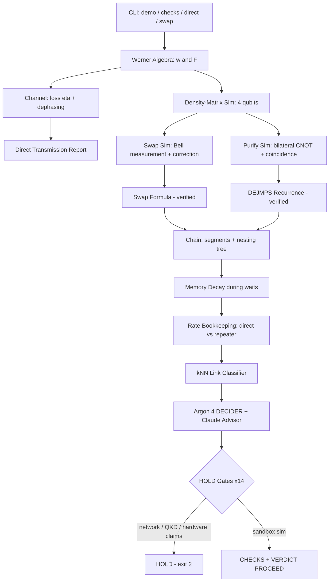
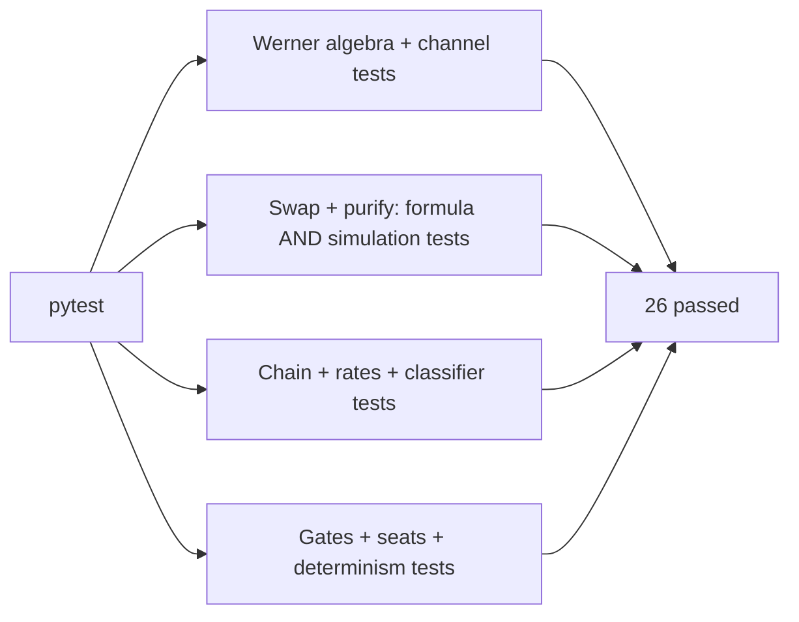
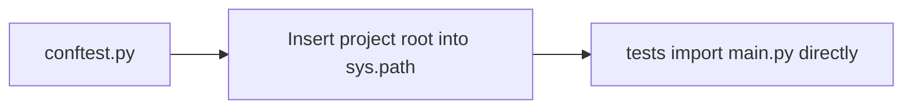
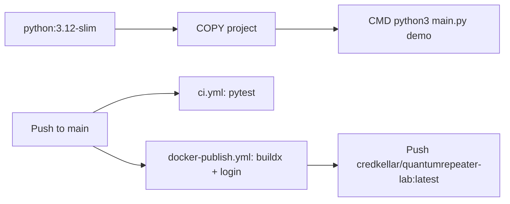

# QuantumRepeater-Lab 🔗⚛️

**Quantum Repeater Chain Lab** — by Darion Kellar

QuantumRepeater-Lab is an **educational quantum repeater lab** in ONE pure-Python file. It starts from the two ways long-distance entanglement distribution dies, and builds the two cures separately so each can be measured on its own:

- **The rate dies exponentially** — at a labelled 0.2 dB/km of fibre loss, one attempt in 10²⁰ succeeds at 1,000 km. The pair that eventually arrives still has fidelity **0.5186** — alive, entangled, and effectively never coming: the expected wait is **5×10¹⁷ s ≈ 1.58×10¹⁰ years**.
- **The fidelity dies multiplicatively** — entanglement swapping multiplies Werner parameters, so a chain of 8 segments swapped without purification delivers **F = 0.4717**, *below* the 1/2 separable line. Fast, and useless.

The lab's answer is the repeater design, with the arithmetic in the open: **segments fix the rate** (125 km links, heralded pairs stored in memories), **purification fixes the fidelity** (DEJMPS rounds at every nesting level burn pairs to buy fidelity back), and **memory decoherence taxes every wait** (T2 = 10 s, labelled). The purified chain delivers **F = 0.8582 every 0.2991 s** at a cost of **1,119 elementary pairs per delivered pair** — all three numbers printed, none hidden. And nothing is taken on faith: the swapping and purification formulas are **verified against an explicit 4-qubit density-matrix simulation** (Bell measurement and bilateral CNOT, built from scratch) inside the same file. 🔬

Honest scope, stated up front: every parameter is a **labelled teaching value** — no photon, fibre, memory, or detector exists here, and no rate in this lab is a network specification. Every quantum-internet / QKD-service / hardware claim sits behind a permanent HOLD gate (14 total). 🔒

[](https://github.com/kimanicollier44-cmyk/QuantumRepeater-Lab/actions/workflows/ci.yml)
[](https://github.com/kimanicollier44-cmyk/QuantumRepeater-Lab/actions/workflows/docker-publish.yml)

> ℹ️ These are the **live** workflow badges for this repo. They activate as soon as the `ci.yml` and `docker-publish.yml` files from the paste pack are pasted into `.github/workflows/` — until then they have nothing to report yet.

## 🧰 Tech Stack Badges & Full Architecture Tech Stack

### 💻 Core Programming Languages & Core Systems


- 🐍 Python 3.12, pure standard library (`math`, `hashlib`, `json`, `sys`) — zero dependencies, zero network, deterministic (double-run byte-identical)
- ⚛️ Werner-state algebra core: one parameter `w` per pair — the channel multiplies it by `exp(−γL)`, swapping multiplies two `w`'s, memory waiting multiplies it by `exp(−t/T2)`, and purification applies the DEJMPS recurrence to `F = (3w + 1)/4` — every rule asserted against its analytic value in CHECKS
- 🔬 Density-matrix simulation from scratch: 16×16 complex matrices as plain lists, Bell-basis projectors, partial traces, Pauli corrections, bilateral CNOT — the swapping formula and the purification recurrence are both reproduced from the matrices to <1e-9 before either is trusted
- 🗺️ Chain bookkeeping: expected-value recursion over a nesting tree (3/2 waiting factor for two links, memory decay during the wait, heralding time `span/c`, purification retries dividing time and multiplying pair cost by `2/p`)
- 🧠 TinyML kNN link classifier (from scratch, stdlib): direct-ok / swap-only / purify-then-swap / hopeless from segment fidelity + segment count + memory margin, labels from the lab's own policy, which itself runs the chain model
- 🪑 Council seats: Gemini Argon 4 DECIDER (names-only, tighten-only) + Muse advisor (never overrides HOLD) + Google Flow plan-only (rendered = False, live = 0)

### ⛓️ Web3 & Infrastructure

- 🚫 **Not applicable — honestly.** No blockchain, no Web3, no tokens: the "infrastructure" in this lab is a labelled model of fibre segments, repeater stations, and memories inside one offline file. Quantum-network deployment is a permanent HOLD gate, not a feature. No fake badges here.

### ⚙️ Platform Support & Hardware Architecture


- 🖥️ Pure Python — runs anywhere Python 3.12+ runs (Linux, macOS, Windows), plus the `python:3.12-slim` Docker image
- 🔒 No hardware is controlled, ever: real repeaters, sources, memories, and detectors are permanent HOLD gates (see the gate table below)

### ⚡ Low-Level Infrastructure & Performance

- 🚫 **No low-level code — honestly.** No C, no C++, no GPU, no compiled extensions: this is one interpreted Python file on purpose, so every fidelity can be read, checked, and diffed. Performance here means honest bookkeeping — closed-form Werner algebra for the chain, and a 16×16 density-matrix simulation used only where a formula needs a witness, all deterministic and byte-identical between runs.

### 🛠️ DevOps & Build Tools


- 🐳 Docker (`python:3.12-slim`), GitHub Actions CI + Docker Publish (delivered in the paste pack)
- 🎯 Target image: `credkellar/quantumrepeater-lab:latest`
- 🧪 Tests: `pytest` (26 tests) + the built-in CHECKS suite (59 checks) in `main.py`

### ☁️ Cloud Providers

- 🚫 **None — honestly.** No cloud provider is used or needed: the lab runs fully offline on your own machine or in a local Docker container. Docker Hub appears only as the registry the publish workflow pushes the image to.

## What this does?

1. 📉 **Direct transmission — the baseline that fails on rate** — a pair created at the labelled source fidelity 0.98 crosses the channel (0.2 dB/km loss, Werner decay γ = 0.001/km): fidelity fades gently — 0.9105 at 100 km, 0.8185 at 250 km, **0.5186 at 1,000 km** — while the success probability falls off a cliff: 10⁻², 10⁻⁵, 10⁻¹⁰, **10⁻²⁰**. The expected wait at 1,000 km is **5×10¹⁷ s ≈ 1.58×10¹⁰ years**. Direct transmission is not too noisy; it is too *rare*.
2. 🔗 **Segments — the rate cure** — cut 1,000 km into 8 segments of 125 km: each segment succeeds with probability 10^-2.5 ≈ 0.00316 per attempt, and with a labelled 100-channel multiplex an elementary pair takes **0.0020 s** expected. Each arrives at **F = 0.8942**. Heralded pairs wait in memories (labelled T2 = 10 s) for their neighbours — that wait is where the next problem lives.
3. 🔀 **Entanglement swapping — exact, and exactly the problem** — a Bell measurement on the two middle qubits plus a Pauli correction stitches two pairs into one longer pair with `F' = F1·F2 + (1−F1)(1−F2)/3`, i.e. the Werner parameters multiply: `w' = w1·w2`. Two segment pairs at 0.8942 swap to **0.8034**. The lab proves the formula with a from-scratch 4-qubit density-matrix simulation: all four Bell outcomes occur with probability exactly 1/4 and every corrected fidelity matches the formula to <1e-9.
4. ♻️ **Purification — fidelity bought with pairs** — one DEJMPS round takes two pairs at F and returns one at `F' = (F² + q²)/(F² + 2Fq + 5q²)`, q = (1−F)/3, succeeding with probability equal to the denominator. From F = 0.75: **0.7885 → 0.8270 → 0.8635 → 0.8959 → 0.9231** over five rounds, while the cumulative cost climbs **2.77 → 7.31 → 18.37 → 44.02 → 101.09 pairs per output**. The bilateral-CNOT density-matrix simulation reproduces the recurrence to <1e-9 — and below F = 1/2 the same recurrence runs *backward* (purify(0.40) = 0.3846): purification cannot start from a separable pair.
5. 🏗️ **The nested chain — purification at every level** — elementary pairs are purified ×2 (F 0.8942 → **0.9434**, cost 5.1 pairs each), then swapped and re-purified level by level: level 1 F = **0.9404** (cost 52.8), level 2 F = **0.9321** (cost 559.4), and the final swap delivers **F = 0.8582 in 0.2991 s** at a total cost of **1,119 elementary pairs**. Every level's fidelity, time, and cost are printed — the repeater's price tag is a first-class output.
6. 🕰️ **Memory decoherence — the tax on waiting** — a stored pair's Werner parameter decays as `exp(−t/T2)` while it waits for its partner (expected wait = the 3/2 factor for two production clocks, plus the heralding trip `span/c`). With T2 = 10 s the tax is affordable; the classifier's dead-memory scenario (T2 ≈ one pair-production time) collapses the same chain to hopeless. Memories are not a detail in this design; they are the budget.
7. ⚖️ **The honest comparison at 1,000 km** — direct: F = 0.5186, one pair per 5×10¹⁷ s. Swap-only repeater: **54.85 pairs/s at F = 0.4717 — separable**, worse than useless. Purified repeater: **3.34 pairs/s at F = 0.8582**, cost 1,119 raw pairs each. Segments alone fix the rate and break the fidelity; purification alone never gets a pair to purify; the design is both, or it is neither.
8. 🏷️ **Link classifier + seats + checks** — a from-scratch kNN labels link designs direct-ok / swap-only / purify-then-swap / hopeless from (segment fidelity, segments, memory margin), with labels generated by a policy that *runs the chain model itself* (campus 0.95 single segment: direct-ok; metro 0.95 × 4: swap-only; the 1,000 km backbone: purify-then-swap; dead memories or a 0.45 source: hopeless), with Argon 4 DECIDER (sha256 trace), Muse advisor, Google Flow plan-only, and a built-in CHECKS suite (59 checks).

## 🗺️ How it works — diagram per script

### `main.py` — the whole lab



### `tests/test_main.py` — verification



### `conftest.py` — test path setup



### `Dockerfile` + CI flow — container & publish



## Why is this cool?

1. ⏳ The direct baseline is a **fidelity that outlives its own universe**: F = 0.5186 at 1,000 km — and an expected wait of 1.58×10¹⁰ years, longer than the age of the universe, computed from one labelled loss figure.
2. 🔬 The formulas have **witnesses**: swapping and purification are each verified against an explicit 4-qubit density-matrix simulation built from scratch in the same file — Bell projectors, partial traces, bilateral CNOT — agreeing to <1e-9.
3. 💸 Purification's price is **printed per round**: 0.75 → 0.9231 in five rounds, and the pair counter climbs 2.77 → 101.09 right beside the fidelity, so the trade is never hidden.
4. 🪦 The swap-only chain is **honestly buried**: 54.85 pairs per second of F = 0.4717 — separable states, delivered quickly. Speed without purification is a faster way to distribute nothing.
5. 🏗️ The nesting tree shows its **whole ledger**: every level prints fidelity, expected time, and pair cost, so you can watch 1,119 elementary pairs condense into one delivered pair at F = 0.8582.
6. 🕰️ Memory decay is **priced, not gestured at**: the same backbone design is purify-then-swap with T2 = 10 s memories and hopeless with dead ones — the classifier's verdict flips on the memory budget alone.
7. 🚫 The recurrence **refuses to start** below F = 1/2: purify(0.40) = 0.3846, computed and checked — the lab shows the exact line where distillation stops being possible.
8. 🎯 Every Bell outcome is **equally likely and equally good**: the simulation shows p = 1/4 four times and the same corrected fidelity four times — teleportation-grade bookkeeping, not a lucky outcome.
9. 🧭 The classifier's labels come from a policy that **runs the lab's own chain model** — the kNN interpolates simulated verdicts, not vibes.
10. 🎯 Deterministic end to end: run it twice, get byte-identical output — a repeater chain you can diff.

## What problems this solves?

1. ❌ **Problem:** "Quantum repeaters will connect quantum computers" is usually stated without a single number. ✅ **Solution:** The full chain is costed — 1,000 km, F = 0.8582, 0.2991 s per pair, 1,119 elementary pairs per delivered pair — from labelled parameters anyone can change and recompute.
2. ❌ **Problem:** Direct-transmission fidelity numbers (0.52 at 1,000 km!) make fibre look almost good enough. ✅ **Solution:** The lab prints the rate next to the fidelity: one success per 10²⁰ attempts is an expected wait of ~1.58×10¹⁰ years. The fidelity was never the binding constraint.
3. ❌ **Problem:** Entanglement swapping is often drawn as a free stitch. ✅ **Solution:** The Werner parameters multiply — two 0.8942 pairs become 0.8034 — and the density-matrix simulation proves the formula outcome by outcome.
4. ❌ **Problem:** Purification gets described as "error correction for entanglement" with no price tag. ✅ **Solution:** Each round prints its success probability and the cumulative pairs-per-output: five rounds from 0.75 cost 101 pairs per surviving pair.
5. ❌ **Problem:** Swap-only repeater diagrams imply rate is the whole problem. ✅ **Solution:** The swap-only chain is computed, not caricatured: F = 0.4717 < 1/2, separable — the lab shows the exact design that fails and why.
6. ❌ **Problem:** Memory coherence is treated as a footnote in repeater explainers. ✅ **Solution:** Waiting decay `exp(−t/T2)` is inside the chain recursion, and the dead-memory scenario flips the backbone verdict to hopeless.
7. ❌ **Problem:** "Purify more" sounds like a universal dial. ✅ **Solution:** Below F = 1/2 the recurrence runs backward (0.40 → 0.3846) — there is a hard floor, and the lab computes on both sides of it.
8. ❌ **Problem:** Repeater rate claims quietly assume free classical communication. ✅ **Solution:** Every combine step pays the heralding trip `span/c` and the 3/2 waiting factor for two production clocks — the classical overhead is in the ledger.
9. ❌ **Problem:** Teaching treatments quote the DEJMPS recurrence without derivation or check. ✅ **Solution:** The bilateral-CNOT protocol is simulated on explicit density matrices and the recurrence is recovered from the matrices to <1e-9.
10. ❌ **Problem:** Simulation tools quietly imply a network is next. ✅ **Solution:** 14 named HOLD gates return exit code 2 for every quantum-internet, QKD-service, deployment, or vendor claim, forever.

## How to install this?

1. 📋 Clone or download this project folder.
2. 🐍 Make sure Python 3.12+ is installed: `python3 --version`
3. ▶️ Run the full demo + checks (no arguments needed):

```bash
python3 main.py
```

4. 🧪 Run the test suite:

```bash
pip install pytest
python3 -m pytest -q
```

5. 🎛️ Try the other commands:

```bash
python3 main.py checks    # 59 built-in checks
python3 main.py direct    # direct transmission table (JSON)
python3 main.py swap      # swapping: simulation vs formula (JSON)
python3 main.py purify    # purification trajectory + simulation (JSON)
python3 main.py chain     # nested repeater chain report (JSON)
python3 main.py rates     # direct vs repeater bookkeeping (JSON)
python3 main.py classify  # kNN link classifier report
python3 main.py brains    # Argon 4 + Muse + Flow seats
python3 main.py holds     # list all 14 HOLD gates
python3 main.py hold-demo # exits 2 - gated actions stay HOLD
```

6. 🐳 Or run it in Docker:

```bash
docker build -t credkellar/quantumrepeater-lab:latest .
docker run --rm credkellar/quantumrepeater-lab:latest
```

## Requirements

- 🐍 Python 3.12 or newer
- 📦 Dependencies: **none** (standard library only)
- 🌐 Network: **none** — fully offline
- 🧪 For tests only: `pytest`
- 🐳 Optional: Docker

## FULL project structure tree

```text
quantumrepeater-lab/
├── main.py                  # the whole lab: Werner algebra, channel, density-matrix swap/purify simulation, DEJMPS recurrence, nested chain, memory decay, rates, classifier, seats, HOLD gates
├── conftest.py              # puts the project root on sys.path for tests
├── tests/
│   └── test_main.py         # 26 pytest tests: algebra, channel, swap + purify formulas AND simulations, chain, rates, classifier, gates, determinism
├── assets/
│   └── cover.png            # README cover image (2736 x 912)
├── Dockerfile               # python:3.12-slim, runs the demo
├── .gitignore               # __pycache__/, .pytest_cache/, *.pyc
└── README.md                # this file
```

> 📦 Delivered separately as paste packs (not in this tree): `.github/workflows/ci.yml` + `docker-publish.yml`, and the Docker Hub pack (100-char description, 350-char About, overview, categories).

## 🔒 HOLD gates — all 14, permanent

| # | Gate | What stays held |
|---|------|-----------------|
| 1 | `quantum_internet_service_claim` | No claim of a working quantum internet service; this is a worksheet, not a network |
| 2 | `qkd_service_claim` | No QKD service or key-distribution claim from model rates |
| 3 | `real_hardware_control` | No control of real repeaters, sources, memories, or detectors |
| 4 | `network_deployment_claim` | No deploying or operating a real quantum network from this lab |
| 5 | `vendor_performance_claim` | No vendor or device performance claims; parameters are labelled, not measured |
| 6 | `live_entanglement_distribution` | No live entanglement distribution directed from a simulation |
| 7 | `teleportation_service_claim` | No teleportation service claims from swapping algebra |
| 8 | `measured_data_claim` | Model outputs must never be presented as measured data |
| 9 | `production_network_design_claim` | No production network design or engineering reliance on a teaching model |
| 10 | `security_certification_claim` | No certifying any system secure or QKD-proof from this lab |
| 11 | `investment_claim` | No investment claims; a lab model is not a prospectus |
| 12 | `regulatory_approval_claim` | No claim of regulatory, telecom, or standards approval |
| 13 | `standards_compliance_claim` | No claim of compliance or interoperability with real quantum hardware or protocols |
| 14 | `remove_human_override` | The human override is never removed |

🧑‍⚖️ **Council seats:** Gemini Argon 4 Extended Thinking — DECIDER (names-only, tighten-only, MAP → MODEL → STRESS → DECIDE, sha256 trace, `can_override_hold = False`) · Muse — advisor (`can_override_hold = False`) · Google Flow — plan-only (`rendered = False`, `live = 0`).

✅ **Verification:** pytest **26 passed** (project + clean copy) · built-in CHECKS **59/59** · double-run output **byte-identical** · `hold-demo` exits **2** · `main.py` **965 lines**, pure stdlib, zero network.

## 🧒 5th-grade English section

Imagine you and a friend each hold one half of a **magic coin pair**: whenever you both flip them, they always land the same way, even far apart. Scientists call that entanglement, and it is the fuel for future quantum networks. 🔗

- Sending one half of the pair through a very long glass fibre is like mailing a snowflake: most of the time it never arrives at all. Over 1,000 km, only **one try in 100,000,000,000,000,000,000** makes it — you would wait longer than the age of the universe. ❄️
- So instead, the trip is cut into **8 short hops**. Each hop is easy to make, and each station keeps its pair half in a **memory** — like a fridge that keeps the magic from melting while it waits. 🧊
- When two neighbouring stations are ready, they do a special measurement that **stitches** their pairs into one longer pair. The stitch works, but every stitch makes the magic a little weaker. Do it with no repairs and the final pair is too weak to count as magic at all. 🪡
- The repair trick is called **purification**: take two weak pairs, compare them, and keep only the best part as one stronger pair. It works — but it eats pairs. Making one really good pair at the end can eat **more than a thousand** ordinary pairs. ♻️
- Put it together and the lab's pretend network delivers a strong pair across 1,000 km about **three times every second** — while mailing the snowflake directly would take longer than the universe has existed. 🚀
- This project is a **pretend lab on a computer**. No real fibres, stations, or magic coins exist here. It helps you learn why connecting quantum computers is both a brilliant idea and a really hard one. 💻

---

MIT © 2026 Darion Kellar · QuantumRepeater-Lab — educational simulation only 🔗
